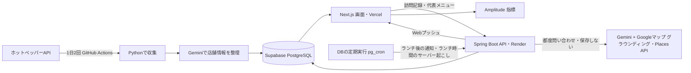

<div align="center">


# 🍱 大阪990円ランチ図鑑

**大阪で今ランチ営業中の990円以下のお店を、近くから選んでくれるWebアプリ**

[アプリを開く](https://osaka-lunch-app.vercel.app) · [한국어](README.md)

[](https://github.com/bettsLee/osaka_lunch_app/actions/workflows/frontend-ci.yml)
[](https://github.com/bettsLee/osaka_lunch_app/actions/workflows/backend-ci.yml)
[](https://github.com/bettsLee/osaka_lunch_app/actions/workflows/collect-shops.yml)


</div>

## なぜ作ったか

日本で暮らしながらランチを選ぶたびに、Googleマップでお店ごとに営業時間と値段を一つずつ確認する必要がありました。

この不便さをテーマに、**課題を自分で見つけ → 作って → リリースし → 数字を見て直す**という流れを、一人で最初から最後までやっています。

## 機能

- 現在地の近くで、**今日ランチ営業しているお店だけ**を表示（価格の上限は790・990・1,190円）
- ルーレット・リスト・地図で選べる。徒歩何分か、ランチは何時までか、価格帯がひと目で分かる
- 結果カードでは、ランチの価格とその根拠になった**店舗情報の原文1行**、Googleマップから探した**代表メニュー・価格帯・お客さんの写真3枚**をまとめて確認。メニューを探す数秒の間は、進行バーと注文のヒントを表示
- ランチ価格が書かれていないお店も、スイッチ一つで地図に表示できる（初期設定はオフ）
- 注文サポート：お店の人に見せる日本語のフレーズ（アレルギー・ベジタリアン・ハラールにも対応）
- お店への到着を検知し、食後に「ランチどうでした？」（営業していたか・値段は合っていたか）を聞いて、自分だけの図鑑に記録
- おすすめリンクの共有、スマホの言語に合わせた多言語表示、ホーム画面に追加（PWA）

## 構成



| 領域 | 技術 | 役割 |
| --- | --- | --- |
| 画面 | Next.js 15・TypeScript・Tailwind CSS（Vercel） | 位置情報に基づくリスト・ルーレット・地図（MapLibre・OpenFreeMap）、PWA、Webプッシュの受信 |
| サーバー | Spring Boot 3.5・Java 17（Render） | 訪問記録、通知の送信、多言語の文言、共有リンク、Googleマップの代表メニュー・写真の中継（保存しない） |
| DB | Supabase PostgreSQL | 店舗・訪問・通知購読の保存、RLS、匿名ログイン、pg_cronの定期実行 |
| 収集・AI | Python・Gemini（GitHub Actions） | 大阪市内12エリアの約4,300店を1日2回取得し、内容が変わったお店だけをAIで整理 |
| 運用 | GitHub Actions・Amplitude | CI、デプロイ後の新バージョン確認、ファネル・再訪問・流入元の指標 |

## 主な判断

### 1. ルールではなくAI。その代わり正解データで確かめる

ホットペッパーの店舗情報を正規表現で読むと、営業曜日まですべて合っていたお店は40%だけでした。Geminiで整理し、自分で作った正解データ30店と比べて、曜日の判定を40% → 100%、990円の判定を87% → 100%に改善しました。

全店に適用したあと無作為に20店を見直したところ19店が一致し、残りの1店はその間に店舗情報が変わっていたケースでした。内容が変わったお店だけを再処理し、AIの費用を1日約0.15ドルに抑えています。

### 2. 1,000円ではなく990円

「1000円～」のようにざっくり書かれた価格は、実際には1,000円を超えることが多いため、基準を990円以下にしました。表示するお店が減っても、信頼できる価格だけを見せることを選びました。

### 3. データの利用条件に合わせた設計

- **ホットペッパー**：運営会社（リクルート）に利用条件を問い合わせ、回答に合わせて修正しました。店舗情報の翻訳をやめ、AIが読み取った価格には「AIが店舗情報から読み取った」ことを表示し、店舗情報の原文は加工せずそのまま見せています。データは24時間以内に取り直しています。
- **Googleマップ**：代表メニュー・価格帯・お客さんの写真は保存せず、カードを開くたびに取得します。出典リンク、「Google Maps」の表記、写真の投稿者もあわせて表示します。お客さんの写真に写ったメニュー表をAIで読み取って価格を出す方法も検討しましたが、Googleマップのコンテンツから新しいコンテンツを作ることは規約に反するため、やめました。

### 4. 代表メニューの空欄を原因ごとに減らす

Googleマップのグラウンディングで代表メニューを付けたあと30店で試すと、メニューが出たのは16店だけでした。空欄を原因ごとに分けると、出典なしで返ってきた答えはすべてAIがGoogleマップを調べていないケースで、もう一度聞くと6店中4店でメニューが見つかりました。

そこで自動で1回だけ聞き直し、それでも出典がなければメニューだけを「AIの推測」として区別して表示します。このとき推測の答えに含まれる価格と営業情報は捨てています。応答時間は中央値で約5.5秒かかるため、待つ間はメニュー欄の枠・進行バー・注文のヒントを表示します。また、ランチ後の「今は閉店中」を閉業と答えてしまうことがあったため、Googleマップで閉業と表示されたお店だけを閉業として案内しています。

### 5. ランチ価格が分からない63%のお店の扱い

集めた4,288店のうち2,688店（63%）は、店舗情報にランチ価格がなくアプリに出ていませんでした。Googleの答えで価格を埋めて保存する方法は規約上使えません。代わりに、スイッチをオンにするとこれらのお店もグレーの点線ピンで表示し、カードではGoogleマップの価格帯を参考として付けるようにしました。オンにすると選べるお店は約4倍になりますが、「990円ランチ」という約束がぼやけないよう、初期設定はオフにしています。

### 6. 実験でやめたアイデア：メニューごとの価格

メニューごとに価格を付けたくて、Geminiに「価格が分かっているメニューやランチセットを優先して選んで」と頼む聞き方を、今の聞き方と同じ30店で比べました。始める前に「30店中10店以上で価格が付いたら切り替える」という基準を決めていました。

結果は、価格が付いたメニューが今の聞き方で0/50、新しい聞き方で0/44。ランチメニューが見つかったお店は10店から6店に減ったため、今の聞き方を続けることにしました。

### 7. 運用中に見つけた問題

- **通知が一度も届いていなかった**：実行ログを見ると、15分ごとに動くはずのGitHubの予定実行が、実際には1日2回しか動いていませんでした。DB側の定期実行（pg_cron）に移し、2か所から同時に呼ばれても1回だけ送るよう、DBのロック（悲観ロック）を入れました。
- **無料サーバーが眠って最初の応答が遅い**：無料サーバーは15分間リクエストがないと止まります。ランチ時間（10:00〜17:50）はDBの定期実行で10分ごとにサーバーを起こしています。

## フォルダ

```
frontend/   Next.jsの画面
backend/    Spring Boot API
batch/      ホットペッパーの収集・AIでの整理・実験スクリプト（Python）
supabase/   DBマイグレーション・確認用クエリ
.github/    CI・収集・通知・デプロイ確認のワークフロー
```

## ローカルで動かす

各フォルダの`.env.example`に必要なキーの名前があります。値はリポジトリに入れません。

```bash
# 画面
cd frontend
cp .env.example .env.local   # 値を入れる
npm install
npm run dev

# サーバー（backend/.env.example の値を環境変数に設定してから）
cd backend
./gradlew bootRun

# 収集（取得のみで保存しない）
python3 batch/collect.py --dry-run
```

## テスト

```bash
cd frontend && npm test
cd backend && ./gradlew test
python3 -m unittest discover -s batch -p 'test_*.py'
```

## 進め方

- すべての判断を「選んだもの・やめたもの・理由・根拠データ」で記録しています（130件以上）
- 変えるかどうか迷うものは、先に基準を決めて小さな実験で確かめます。公開リポジトリの実験ログには数字だけを残します
- 機能ごとにブランチ → PR → CI → デプロイ。デプロイ後は、画面とサーバーが新しいバージョンで動いているかを自動で確認します
- AIツール（Claude Code）と一緒に設計・実装・レビューを行い、何を作るかは自分で決めています

## 進捗

- [x] MVP、店舗データの収集、AIでの整理（2026.10）
- [x] 結果カードにGoogleマップの代表メニュー・価格帯・お客さんの写真、価格不明のお店の表示（2026.11）
- [ ] 知人とのベータテスト（2026.11.17〜20）→ リリース（2026.11.24）
- [ ] リリース後の数字を見て次の改善を選ぶ（A/Bテスト、負荷テスト）

## データ出典

- 店舗情報：[Powered by ホットペッパーグルメ Webサービス](http://webservice.recruit.co.jp/)
- 代表メニュー・価格帯・お客さんの写真：Google Maps（保存せず、アプリ内で出典と写真の投稿者を表示）
- 地図：[OpenFreeMap](https://openfreemap.org) · © [OpenMapTiles](https://www.openmaptiles.org/) · © [OpenStreetMap](https://www.openstreetmap.org/copyright) contributors

AIが整理した値は、アプリ内で「AI」と表示しています。

---

作った人：イ・サングォン（企画・開発・運用）
