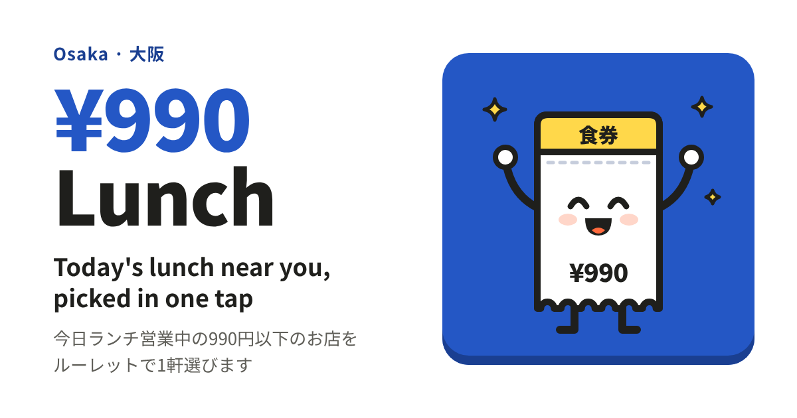
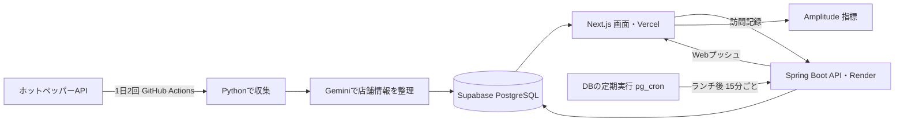

<div align="center">



# 🍱 大阪990円ランチ図鑑

**大阪で今ランチ営業中の990円以下のお店を、近くから選んでくれるWebアプリ**

[アプリを開く](https://osaka-lunch-app.vercel.app) · [한국어](README.md)

[](https://github.com/bettsLee/osaka_lunch_app/actions/workflows/frontend-ci.yml)
[](https://github.com/bettsLee/osaka_lunch_app/actions/workflows/backend-ci.yml)
[](https://github.com/bettsLee/osaka_lunch_app/actions/workflows/collect-shops.yml)


</div>

## なぜ作ったか

日本で暮らしながらランチを選ぶたびに、Googleマップでお店ごとに営業時間と値段を一つずつ確認する必要がありました。

この不便さをテーマに、**課題を自分で見つけ → 作って → リリースし → 数字を見て直す**という流れを、一人で最初から最後までやっています。

## 機能

- 現在地の近くで、**今日ランチ営業しているお店だけ**を表示（価格の上限は790・990・1,190円）
- ルーレット・リスト・地図で選べる。徒歩何分か、ランチは何時までか、価格帯がひと目で分かる
- 注文サポート：お店の人に見せる日本語のフレーズ（アレルギー・ベジタリアン・ハラールにも対応）
- お店への到着を検知し、食後に「ランチどうでした？」（営業していたか・値段は合っていたか）を聞いて、自分だけの図鑑に記録
- おすすめリンクの共有、スマホの言語に合わせた多言語表示、ホーム画面に追加（PWA）

## 構成



| 領域 | 技術 | 役割 |
| --- | --- | --- |
| 画面 | Next.js 15・TypeScript・Tailwind CSS（Vercel） | 位置情報に基づくリスト・ルーレット・地図、PWA、Webプッシュの受信 |
| サーバー | Spring Boot 3.5・Java 17（Render） | 訪問記録、通知の送信、多言語の文言、共有リンク |
| DB | Supabase PostgreSQL | 店舗・訪問・通知購読の保存、RLS、匿名ログイン、pg_cronの定期実行 |
| 収集・AI | Python・Gemini（GitHub Actions） | 大阪の約4,300店を1日2回取得し、内容が変わったお店だけをAIで整理 |
| 運用 | GitHub Actions・Amplitude | CI、デプロイ後の新バージョン確認、ファネル・再訪問の指標 |

## 主な判断

### 1. ルールではなくAI。その代わり正解データで確かめる

ホットペッパーの店舗情報を正規表現で読むと、営業曜日まですべて合っていたお店は40%だけでした。Geminiで整理し、自分で作った正解データ30店と比べて、曜日の判定を40% → 100%、990円の判定を87% → 100%に改善しました。全店に適用したあと無作為に20店を見直したところ19店が一致し、残りの1店はその間に店舗情報が変わっていたケースでした。内容が変わったお店だけを再処理し、AIの費用を1日約0.15ドルに抑えています。

### 2. 1,000円ではなく990円

「1000円～」のようにざっくり書かれた価格は、実際には1,000円を超えることが多いため、基準を990円以下にしました。表示するお店が減っても、信頼できる価格だけを見せることを選びました。

### 3. データの利用条件を自分で確認

ホットペッパーの運営会社（リクルート）に利用条件を問い合わせ、回答に合わせて修正しました。店舗情報の翻訳をやめ、AIが作った値には「AI」表示を付け、データは24時間以内に取り直しています。

### 4. 通知が一度も届いていなかった問題

実行ログを見ると、15分ごとに動くはずのGitHubの予定実行が、実際には1日2回しか動いていませんでした。DB側の定期実行（pg_cron）に移し、2か所から同時に呼ばれても1回だけ送るよう、DBのロック（悲観ロック）を入れました。

## フォルダ

```
frontend/   Next.jsの画面
backend/    Spring Boot API
batch/      ホットペッパーの収集・AIでの整理（Python）
supabase/   DBマイグレーション・確認用クエリ
.github/    CI・収集・通知・デプロイ確認のワークフロー
```

## ローカルで動かす

各フォルダの`.env.example`に必要なキーの名前があります。値はリポジトリに入れません。

```bash
# 画面
cd frontend
cp .env.example .env.local   # 値を入れる
npm install
npm run dev

# サーバー（backend/.env.example の値を環境変数に設定してから）
cd backend
./gradlew bootRun

# 収集（取得のみで保存しない）
python3 batch/collect.py --dry-run
```

## テスト

```bash
cd frontend && npm test
cd backend && ./gradlew test
python3 -m unittest discover -s batch -p 'test_*.py'
```

## 進め方

- すべての判断を「選んだもの・やめたもの・理由・根拠データ」で記録しています（110件以上）
- 機能ごとにブランチ → PR → CI → デプロイ。デプロイ後は、画面とサーバーが新しいバージョンで動いているかを自動で確認します
- AIツール（Claude Code）と一緒に設計・実装・レビューを行い、何を作るかは自分で決めています

## 進捗

- [x] MVP、店舗データの収集、AIでの整理（2026.10）
- [ ] 知人とのベータテスト（2026.11）→ リリース（2026.12）
- [ ] A/Bテスト、負荷テスト、失敗処理のキュー（2026.12）

## データ出典

店舗情報：[Powered by ホットペッパーグルメ Webサービス](http://webservice.recruit.co.jp/)

AIが整理した値は、アプリ内で「AI」と表示しています。

---

作った人：イ・サングォン（企画・開発・運用）
