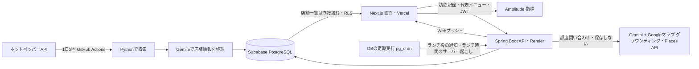

<div align="center">


# 🍱 大阪990円ランチ図鑑

**大阪で今ランチ営業中の990円以下のお店を、近くから選んでくれるWebアプリ**

[アプリを開く](https://osaka-lunch-app.vercel.app) · [한국어](README.md)

[](https://github.com/bettsLee/osaka_lunch_app/actions/workflows/frontend-ci.yml)
[](https://github.com/bettsLee/osaka_lunch_app/actions/workflows/backend-ci.yml)
[](https://github.com/bettsLee/osaka_lunch_app/actions/workflows/collect-shops.yml)


</div>

## なぜ作ったか

日本で暮らしながらランチを選ぶたびに、Googleマップでお店ごとに営業時間と値段を一つずつ確認する必要がありました。

この不便さをテーマに、**課題を自分で見つけ → 作って → リリースし → 数字を見て直す**という流れを、一人で最初から最後までやっています。

## 機能

- 現在地の近くで、**今日ランチ営業しているお店だけ**を表示（価格の上限は790・990・1,190円）
- ルーレット・リスト・地図で選べる。徒歩何分か、ランチは何時までか、価格帯がひと目で分かる
- 結果カードでは、ランチの価格とその根拠になった**店舗情報の原文1行**、Googleマップから探した**代表メニュー・価格帯・お客さんの写真（最大6枚、横にスワイプ）**をまとめて確認。メニューを探す数秒の間は、マスコットのしょっけんが進行バーの上を走り、注文のヒントを表示
- ランチ価格が書かれていないお店も、スイッチ一つで地図に表示できる（初期設定はオフ）
- 注文サポート：お店の人に見せる日本語のフレーズ（アレルギー・ベジタリアン・ハラールにも対応）
- お店への到着を検知し、食後に「ランチどうでした？」（営業していたか・値段は合っていたか）を聞いて、自分だけの図鑑に記録
- おすすめリンクの共有、スマホの言語に合わせた多言語表示、ホーム画面に追加（PWA）
- マスコットの**しょっけん**：トップ画面の券売機から出てきた食券1枚がキャラクターになりました。メイン画面のボタンの後ろからのぞき、ルーレットの間は走り、お店がないときや到着したときに表情が変わる

## 構成



| 領域 | 技術 | 役割 |
| --- | --- | --- |
| 画面 | Next.js 15・TypeScript・Tailwind CSS（Vercel） | 位置情報に基づくリスト・ルーレット・地図（MapLibre・OpenFreeMap）、PWA、Webプッシュの受信 |
| サーバー | Spring Boot 3.5.16・Java 17・Spring Security・JPA（Render） | 訪問記録、通知の送信、多言語の文言、共有リンク、Googleマップの代表メニュー・写真の中継（保存しない） |
| DB | Supabase PostgreSQL | 店舗・訪問・通知購読の保存、RLS、匿名ログイン、pg_cronの定期実行 |
| 収集・AI | Python・Gemini（GitHub Actions） | 大阪市内12エリアの約4,300店を1日2回取得し、内容が変わったお店だけをAIで整理 |
| 運用 | GitHub Actions・Amplitude | CI、デプロイ後の新バージョン確認、ファネル・再訪問・流入元の指標 |

### 読み取りと書き込みを分けた理由

- **読み取り（店舗一覧・ルーレット・地図）**：ブラウザがSupabaseのRESTから直接読みます。店舗テーブルはRLSで「誰でも読める・書き込みはバッチだけ」にしています。無料サーバーが眠っていても、最初の画面はすぐに表示されます。
- **書き込みと外部呼び出し（訪問記録・通知購読・代表メニュー・写真・翻訳）**：Spring Bootのサーバーを通します。Supabaseの匿名ログインが発行したJWTを、サーバーが自分で検証します（署名・発行元・対象）。GeminiとGoogleのキーはサーバーだけに置き、1日の呼び出し上限で費用が増えないようにしています。
- **定期実行**：収集はGitHub Actions、通知とサーバー起こしはDBの定期実行（pg_cron）が担当します。

## 主な判断

### 1. ルールではなくAI。その代わり正解データで確かめる

ホットペッパーの店舗情報を正規表現で読むと、営業曜日まですべて合っていたお店は40%だけでした。Geminiで整理し、自分で作った正解データ30店と比べて、曜日の判定を40% → 100%、990円の判定を87% → 100%に改善しました。

全店に適用したあと無作為に20店を見直したところ19店が一致し、残りの1店はその間に店舗情報が変わっていたケースでした。内容が変わったお店だけを再処理し、AIの費用を1日約0.15ドルに抑えています。（実装は[技術 1](#1-ai整理パイプライン精度費用失敗をまとめて管理)）

### 2. 1,000円ではなく990円

「1000円～」のようにざっくり書かれた価格は、実際には1,000円を超えることが多いため、基準を990円以下にしました。表示するお店が減っても、信頼できる価格だけを見せることを選びました。

### 3. データの利用条件に合わせた設計

- **ホットペッパー**：運営会社（リクルート）に利用条件を問い合わせ、回答に合わせて修正しました。店舗情報の翻訳をやめ、AIが読み取った価格には「AIが店舗情報から読み取った」ことを表示し、店舗情報の原文は加工せずそのまま見せています。データは24時間以内に取り直しています。
- **Googleマップ**：代表メニュー・価格帯・お客さんの写真は保存せず、カードを開くたびに取得します。出典リンク、「Google Maps」の表記、写真の投稿者もあわせて表示します。お客さんの写真に写ったメニュー表をAIで読み取って価格を出す方法も検討しましたが、Googleマップのコンテンツから新しいコンテンツを作ることは規約に反するため、やめました。料理の写真だけを選んで見せることも同じ理由でしていません（Googleの写真には料理・店舗といった種類の情報もありません）。代わりに写真を6枚まで取得して横にスワイプできるようにし、料理の写真を見られる確率を上げました。

### 4. 代表メニューの空欄を原因ごとに減らす

Googleマップのグラウンディングで代表メニューを付けたあと30店で試すと、メニューが出たのは16店だけでした。空欄を原因ごとに分けると、出典なしで返ってきた答えはすべてAIがGoogleマップを調べていないケースで、もう一度聞くと6店中4店でメニューが見つかりました。

そこで自動で1回だけ聞き直し、それでも出典がなければメニューだけを「AIの推測」として区別して表示します。このとき推測の答えに含まれる価格と営業情報は捨てています。また、ランチ後の「今は閉店中」を閉業と答えてしまうことがあったため、Googleマップで閉業と表示されたお店だけを閉業として案内しています。（実装は[技術 4](#4-遅い外部aiを待つ画面)）

リリース前（11/23）にランダムに選び直した30店で聞くと、Googleマップの出典付きでメニューが出たのは21店、AIの推測まで含めると23店でした。残った空欄7店のうち6店はGoogleにメニュー情報そのものがないお店で、聞き直しで減らせる部分はほとんど残っていません。（その間にお店のリストが変わったため、11/17と同じ30店ではありません）

### 5. ランチ価格が分からない63%のお店の扱い

集めた4,288店のうち2,688店（63%）は、店舗情報にランチ価格がなくアプリに出ていませんでした。Googleの答えで価格を埋めて保存する方法は規約上使えません。代わりに、スイッチをオンにするとこれらのお店もグレーの点線ピンで表示し、カードではGoogleマップの価格帯を参考として付けるようにしました。オンにすると選べるお店は約4倍になりますが、「990円ランチ」という約束がぼやけないよう、初期設定はオフにしています。

### 6. 実験でやめたアイデア：メニューごとの価格

メニューごとに価格を付けたくて、Geminiに「価格が分かっているメニューやランチセットを優先して選んで」と頼む聞き方を、今の聞き方と同じ30店で比べました。始める前に「30店中10店以上で価格が付いたら切り替える」という基準を決めていました。

結果は、価格が付いたメニューが今の聞き方で0/50、新しい聞き方で0/44。ランチメニューが見つかったお店は10店から6店に減ったため、今の聞き方を続けることにしました。

### 7. トップ画面とマスコット：ランチのお店の券売機から

トップ画面は地図のイラストと価格のピンで、ほかの地図アプリと見分けがつきませんでした。日本の安いランチのお店の入口にある券売機を持ってきて、ランプがついたボタン1つが「アプリが選んだお店」になるようにしました。ルーレットで1軒に決めるというアプリの中心と同じ意味です。ボタンのジャンル名はすでに翻訳済みの文言を使っているので、デザインを変えても新しく翻訳する文言はありません。

券売機から出てきた食券は、マスコットのしょっけん（国ごとに 식권이・しょっけん・小食券・Shokken）になりました。「食券」は韓国語・日本語・中国語で同じ漢字なので、どの国の人にも意味が通じます。体にはお店の価格ではなくアプリの上限¥990を書き、到着画面などでお店の価格と読み違えないようにしました。メイン画面での置き場所は、地図上の現在地・ボタンの後ろ・吹き出しの3案を実際の画面で撮って比べ、ボタンの後ろに決めました。地図上の現在地は、すぐ近くのお店の価格ピンを隠してしまう問題がありました。

## 技術的に解いた問題

### 1. AI整理パイプライン：精度・費用・失敗をまとめて管理

[`batch/ai_structure.py`](batch/ai_structure.py) · [`batch/structure_shops.py`](batch/structure_shops.py) · [`batch/collect.py`](batch/collect.py)

- **ハルシネーション対策**：AIが「990円以下」と答えても、根拠として挙げた文言が店舗情報の原文にそのまま無ければ「不明」に下げます。正解データの採点スクリプト（[`batch/eval_ai.py`](batch/eval_ai.py)）で、正規表現とAIを同じ指標で比べます。
- **変わったものだけ再処理**：店舗情報のSHA-256ハッシュ・モデル・プロンプトのバージョンのどれかが変わったお店と、前回失敗したお店だけをAIに送ります。最初の全件処理（約2,900店）は23分かかりましたが、普段は数分で終わります。
- **実行の管理**：スレッドプールで32件を同時に処理し、45分を過ぎたら残りは次回に回します。失敗が半分を超えたら（3件以上）キーや上限の問題とみなし、バッチを失敗で終わらせて気づけるようにしています。
- **収集の安全装置**：規約上24時間以内に更新する必要があるため、今回の収集に出てこなかったお店は削除します。ただし取得件数が既存の半分にも満たない場合はAPIの異常とみなし、削除せずに止めます。定期実行が遅れても24時間を超えないよう、1日2回動かしています。

### 2. 無料サーバーが眠る環境でも速く

無料サーバー（Render）は15分間リクエストがないと眠り、眠ったあとの最初のリクエストはサーバーが起きるまで待つ必要があります。

- 店舗一覧はサーバーを通さず、Supabaseから直接読みます。
- ルーレットが回っている間にサーバーの`/health`を呼んで起こし、同時に当たったお店の代表メニューも先に問い合わせておきます（プリフェッチ）。
- 「ここに行く」はまずブラウザの送信待ち箱（outbox、localStorage）に入れ、裏で送ります。記録のID（UUID）をブラウザが作るので、サーバーが眠っていて同じリクエストを送り直しても1回だけ保存されます（冪等）。3日を過ぎた記録は捨てます。（[`frontend/lib/api.ts`](frontend/lib/api.ts)）
- ランチ時間（10:00〜17:50）は、DBの定期実行が10分ごとにサーバーを起こします。

### 3. 「ランチどうでした？」Webプッシュ

[`push/PushJob.java`](backend/src/main/java/com/osakalunch/backend/push/PushJob.java) · [`push/WebPushCrypto.java`](backend/src/main/java/com/osakalunch/backend/push/WebPushCrypto.java) · [`visit/VisitRepository.java`](backend/src/main/java/com/osakalunch/backend/visit/VisitRepository.java)

- **問題**：通知が一度も届いていませんでした。実行ログを見ると、15分ごとに動くはずのGitHub Actionsの予定実行が、実際には1日2回ほどしか動いていませんでした。
- **解決**：定期実行をSupabaseのpg_cronに移し、GitHub Actionsは予備として残しました。2か所から同時に呼ばれても同じ記録に2回送らないよう、送信対象を選ぶクエリに悲観ロック（`PESSIMISTIC_WRITE`）をかけています。通知をオフにしたブラウザ（404・410）の購読は削除し、一時的な失敗だけを次回に再送します。
- **自前で実装**：Web Pushの暗号化（RFC 8291 aes128gcm：ECDH → HKDF → AES-GCM）とVAPID認証（ES256 JWT）をライブラリを使わずJava標準APIで実装し、RFCの例の値と同じ暗号文になるかをテストしています。購読を保存するときは、ブラウザの公開鍵がP-256曲線上の点かどうかを確認します。

### 4. 遅い外部AIを待つ画面

[`menu/MenuHintClient.java`](backend/src/main/java/com/osakalunch/backend/menu/MenuHintClient.java) · [`components/MenuHintBlock.tsx`](frontend/components/MenuHintBlock.tsx)

Googleマップのグラウンディングの応答は中央値で約5.5秒、長いと10秒を超えます。

- **時間の予算内でだけ再試行**：全体20秒の中で、答えにGoogleマップの根拠（`groundingChunks`）が無いときだけもう一度聞きます。残り時間が4秒未満のときや、すでにタイムアウトで終わったときは聞き直しません。
- **費用の上限**：グラウンディングの無料枠（月5,000回）に合わせて1日150回（大阪の日付基準）の上限を設け、再試行も同じ上限で数えます。写真はPlaces APIのフィールドマスクを`photos`だけに絞って一番安い料金区分を使い、1日33枚（月の無料枠1,000枚以内）に抑えています。カードごとに6枚分を確保し、写真が少ないお店は実際に取得した枚数だけを上限から差し引きます。使った数はサーバーのメモリではなくDBで数えるので、無料サーバーが休んでから起き直しても、その日の上限が最初から開き直すことはありません。
- **保存しない**：応答に`Cache-Control: no-store`を付け、ブラウザや中間サーバーにも残らないようにしています。
- **画面**：待ち時間の文言を0・4・9・15秒で切り替え、進行バーと注文のヒントを表示します。答えが届いたら1.2秒だけ高さを保ってから縮め、下のボタンが急に上がって押し間違えないようにしました。

### 5. 多言語：必要な言語だけ一度翻訳して保存

[`i18n/TranslationService.java`](backend/src/main/java/com/osakalunch/backend/i18n/TranslationService.java)

- 韓国語と英語はアプリに入れておき、それ以外の言語はその言語のスマホで初めて開いたときに、サーバーがGeminiで一度だけ翻訳してDBに保存します。原文や指示文のバージョンが変わったら翻訳し直します。
- 翻訳結果の`{差し込み}`が原文と一つでも違えば使いません。新しい翻訳は1時間に20件までに制限し、言語コードを変えながら呼ばれても費用が増えないようにしています。
- ベトナム語で「以下（≤）」を「未満（<）」と訳した文言が11件中8件ありましたが、指示文を直して11件すべて正しくしました。

### 6. デプロイ確認の自動化

[`.github/workflows/deploy-check.yml`](.github/workflows/deploy-check.yml)

- **問題**：Vercelの環境変数にあるサーバーのURLの末尾に`/health`が付いていて、アプリからのサーバー呼び出しがすべて404でした。テストとCIは通っていたため気づけませんでした。
- **解決**：mainにマージされると、① Vercelの本番デプロイがこのコミットで終わったか ② デプロイされた画面のコード（JS）が本番サーバーのURLを使っているか ③ Renderの`/health`が返すコミットが正しいかを自動で確認します。サーバーのコードが変わっていないコミットではサーバーが再デプロイされないため、③は最後のサーバーコミット以降にサーバーのコードの変更が無ければ通過とします。

### 7. 脆弱性への対応：Java4ShellとSpring Bootの更新

[`backend/Dockerfile`](backend/Dockerfile) · [`backend/build.gradle`](backend/build.gradle)

- **問題**：2026年11月17日、JDKの脆弱性Java4Shell（CVE-2026-114938）が公開されました。AVX-512 VBMIに対応したx86 CPUで、JDKの高速Base64デコーダーが細工された入力を受け取るとバッファの外にデータを書き込みます。Java 17.0.6以降が対象です。
- **判断**：サーバーが使うTemurin 17はパッチ版が確認できず、RenderサーバーのCPUの種類も確認できませんでした。コードで`java.util.Base64`を使って外部入力をデコードしているのはWebプッシュ購読の鍵の1か所だけなのでリスクは低いと判断しましたが、対策のコストが小さいためすぐに塞ぎました。
- **対応**：まずサーバーの起動オプション`-XX:-UseBASE64Intrinsics`で、問題の高速経路だけを無効にしました（11/18）。Temurinのパッチ版（17.0.21.1+2）が出たあとは、サーバーのイメージタグをそのバージョンに固定してオプションを外しました（11/23）。タグを固定したのは古いイメージのキャッシュを使い回さないためで、バックエンドのCIがサーバーのイメージを実際にビルドし、Javaのバージョンをプルリクエストの画面に残すようにしました。
- **依存関係**：Spring Bootを3.5.0から3.5.16（Spring Framework 6.2.19・Spring Security 6.5.11・Tomcat 10.1.55）に上げました。3.5系の最後の無償版です。3.5の無償サポートは2026年6月に終わったため、4.xへの移行を次の課題にしています。

### 8. マスコットのアニメーション：軽く、止められるように

[`components/Shokken.tsx`](frontend/components/Shokken.tsx) · [`components/FirstRun.tsx`](frontend/components/FirstRun.tsx)

- 表情4つ（基本・おなかすいた・見つけた・走る）を1つのSVGコンポーネントで描き、画像ファイルなしで場所ごとに大きさだけ変えて使っています。アプリのアイコンとリンクのプレビュー画像も同じ絵をもとに作りました。
- 走るときは、腰と肩を軸に手足をCSSアニメーションで振ります。最初は体の傾き（SVGの`transform`属性）と跳ねるCSSアニメーションを同じ`<g>`に置いていましたが、ヘッドレスChromeで画面をチェックしていて体が描かれないことに気づき、2つの要素に分けました。
- スマホで「視差効果を減らす」をオンにしている人には、すべての動きを止めます（`prefers-reduced-motion`）。トップ画面は縦760px以下の画面では文字・余白・食券を小さくして、iPhone SEのサイズ（375×667）でもスタートボタンが最初の画面に収まるようにしました。最初は食券ごと外していましたが、ノートパソコンのブラウザでしょっけんが見えなかったため、小さく残す形に変えました。
- トップ画面の7セグメント表示の数字はアプリの価格上限の値から描くので、上限が変わっても絵を作り直す必要はありません。

## データとセキュリティ

| テーブル | 中身 | アクセス |
| --- | --- | --- |
| `shops` | ホットペッパーの店舗情報（1日2回更新） | 誰でも読める、書き込みはバッチだけ |
| `shop_ai` | AIの整理結果（曜日ごとのランチ営業・価格・根拠の文言・ハッシュ） | 誰でも読める、書き込みはバッチだけ |
| `visits` | 「ここに行く」・到着・回答 | 自分の分だけ読める、書き込みはサーバー |
| `push_subscriptions` | Webプッシュの購読 | サーバーだけ |
| `translations` | 言語ごとのアプリ文言の翻訳 | サーバーだけ |
| `opinions` · `share_links` | ご意見・おすすめリンク | サーバーだけ |

- すべてのテーブルでRLSを有効にし、ポリシーの無いテーブルはブラウザからアクセスできません。
- Googleマップのコンテンツを保存するテーブルはありません。訪問記録に残したホットペッパーの店名は、24時間を過ぎるとバッチが消します。
- ログにはプッシュ購読のURL全体を残しません。利用者を特定できる値なので、ホスト名だけを残します。
- 秘密の値はGitHub SecretsとVercel・Renderの環境変数だけに置き、リポジトリには`.env.example`に名前だけを置いています。

## テストとCI

| 領域 | ツール | 数 | 内容 |
| --- | --- | --- | --- |
| サーバー | JUnit・MockMvc | 64件 | CIでは本物のPostgreSQL 16コンテナで実行。Gemini・Places APIの応答は偽物に差し替えて、再試行・上限・タイムアウトを確認 |
| 画面 | node:test | 67件 | 価格の判定、到着の判定（GPSの誤差が100mを超えたら判定しない）、サーバー応答の検証、送信待ち箱、大阪の外の座標を除く処理 |
| バッチ | unittest | 28件 | ランチ時間のルール、失敗したお店の扱い（大半が失敗したら止める）、24時間を過ぎた店名の削除 |

- 画面とサーバーのCIがそれぞれ動き、mainにマージされるとデプロイ確認が続けて動きます。バッチのテストは今のところローカルだけで実行しています。
- Geminiの聞き方を変えるかどうかの実験は、実験用ブランチにpushすると動くワークフローで本物のAPIを呼んで比べます。公開ログには数字だけを残し、mainにはマージしません。

## フォルダ

```
frontend/   Next.jsの画面（components/ 画面、lib/ 画面以外のロジックとテスト）
backend/    Spring Boot API（visit・push・menu・i18n・share・opinion）
batch/      ホットペッパーの収集・AIでの整理・正解データの採点・実験スクリプト（Python）
supabase/   DBマイグレーション（001〜015）・確認用クエリ
.github/    CI・収集・通知・デプロイ確認のワークフロー
```

## ローカルで動かす

各フォルダの`.env.example`に必要なキーの名前があります。値はリポジトリに入れません。

```bash
# 画面
cd frontend
cp .env.example .env.local   # 値を入れる
npm install
npm run dev

# サーバー（backend/.env.example の値を環境変数に設定してから）
cd backend
./gradlew bootRun

# 収集（取得のみで保存しない）
python3 batch/collect.py --dry-run
```

## テストの実行

```bash
cd frontend && npm test
cd backend && ./gradlew test
python3 -m unittest discover -s batch -p 'test_*.py'
```

## 進め方

- すべての判断を「選んだもの・やめたもの・理由・根拠データ」で記録しています（130件以上）
- 変えるかどうか迷うものは、先に基準を決めて小さな実験で確かめます
- 機能ごとにブランチ → PR → CI → デプロイ。デプロイ後は、画面とサーバーが新しいバージョンで動いているかを自動で確認します
- AIツール（Claude Code）と一緒に設計・実装・レビューを行い、何を作るかは自分で決めています

## 進捗

- [x] MVP、店舗データの収集、AIでの整理（2026.10）
- [x] 結果カードにGoogleマップの代表メニュー・価格帯・お客さんの写真、価格不明のお店の表示（2026.11）
- [x] トップ画面の券売機・マスコットのしょっけん（2026.11.23）
- [ ] 知人6人とのベータテスト（2026.11.20〜26、11.24にアンケート）→ アンケートを反映してリリース（2026.11.30）
- [ ] リリース後の数字を見て次の改善を選ぶ（A/Bテスト、負荷テスト）

## データ出典

- 店舗情報：[Powered by ホットペッパーグルメ Webサービス](http://webservice.recruit.co.jp/)
- 代表メニュー・価格帯・お客さんの写真：Google Maps（保存せず、アプリ内で出典と写真の投稿者を表示）
- 地図：[OpenFreeMap](https://openfreemap.org) · © [OpenMapTiles](https://www.openmaptiles.org/) · © [OpenStreetMap](https://www.openstreetmap.org/copyright) contributors

AIが整理した値は、アプリ内で「AI」と表示しています。

---

作った人：イ・サングォン（企画・開発・運用）
