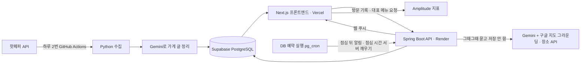

<div align="center">


# 🍱 오사카 990엔 점심 도감

**오사카에서 지금 점심 영업 중인 990엔 이하 가게를 근처에서 골라 주는 웹 앱**

[앱 열어 보기](https://osaka-lunch-app.vercel.app) · [日本語](README.ja.md)

[](https://github.com/bettsLee/osaka_lunch_app/actions/workflows/frontend-ci.yml)
[](https://github.com/bettsLee/osaka_lunch_app/actions/workflows/backend-ci.yml)
[](https://github.com/bettsLee/osaka_lunch_app/actions/workflows/collect-shops.yml)


</div>

## 만든 이유

일본에서 점심을 고를 때마다 구글맵에서 가게별 영업시간과 가격을 하나하나 확인해야 해서 번거로웠습니다.

이 문제를 직접 풀어 보려고 기획부터 개발, 출시, 운영까지 혼자 진행하고 있습니다.

## 주요 기능

- 현재 위치 근처에서 **오늘 점심 영업 중인 가게만** 보여 줍니다. 가격 상한은 790엔, 990엔, 1,190엔 중에서 고를 수 있습니다.
- 룰렛, 목록, 지도 중 편한 방식으로 고르고, 걸어서 몇 분인지와 점심 마감 시간, 가격대를 한 화면에서 확인합니다.
- 결과 카드에서 점심 가격과 그 근거가 된 **가게 글 원문 한 줄**, 구글 지도에서 찾은 **대표 메뉴 · 가격대 · 손님 사진 3장**을 함께 봅니다. 메뉴를 찾는 몇 초 동안에는 진행 막대와 주문 팁을 보여 줍니다.
- 점심 가격이 적혀 있지 않은 가게도 스위치 하나로 지도에 함께 띄울 수 있습니다. (기본은 꺼짐)
- 주문 도우미가 직원에게 보여 줄 일본어 문장을 띄워 줍니다. 알레르기, 채식, 할랄 설정도 반영됩니다.
- 가게에 도착하면 자동으로 기록하고, 식사 후에는 영업 여부와 가격이 맞았는지 묻습니다. 다녀온 가게는 나만의 도감에 쌓입니다.
- 맛집 추천 링크 공유, 휴대폰 언어에 맞춘 다국어, 홈 화면 추가(PWA)를 지원합니다.

## 구조



| 영역 | 기술 | 역할 |
| --- | --- | --- |
| 프론트엔드 | Next.js 15, TypeScript, Tailwind CSS (Vercel) | 위치 기반 목록·룰렛·지도(MapLibre, OpenFreeMap), PWA, 웹 푸시 수신 |
| 백엔드 | Spring Boot 3.5, Java 17 (Render) | 방문 기록, 알림 발송, 다국어 문구, 공유 링크, 구글 지도 대표 메뉴·사진 전달 (저장하지 않음) |
| DB | Supabase PostgreSQL | 가게·방문·알림 구독 데이터, RLS, 익명 로그인, pg_cron 예약 |
| 수집·AI | Python, Gemini (GitHub Actions) | 오사카 시내 12개 지역 가게 약 4,300곳을 하루 2번 수집하고, 소개 글이 바뀐 가게만 AI로 정리 |
| 운영 | GitHub Actions, Amplitude | CI, 배포 후 버전 확인, 퍼널·재방문·유입 경로 지표 |

## 주요 의사결정

### 1. 정규식 대신 AI로 정리하고, 정답지로 정확도 검증

핫페퍼의 가게 소개 글을 정규식으로 읽었을 때, 영업 요일을 모두 맞힌 가게는 40%에 그쳤습니다. 그래서 Gemini로 글을 정리하고 직접 만든 정답지 30곳과 비교해, 요일 판정 정확도를 40%에서 100%로, 990엔 판정을 87%에서 100%로 올렸습니다.

전체 가게에 적용한 뒤 무작위로 20곳을 다시 확인한 결과 19곳이 일치했습니다. 나머지 1곳은 그사이 가게 글이 바뀐 경우였습니다. 지금은 글이 바뀐 가게만 다시 처리해 AI 비용을 하루 약 $0.15로 유지하고 있습니다.

### 2. 기준 가격을 1,000엔이 아닌 990엔으로

'1000円～'처럼 대략 적힌 가격은 실제로 1,000엔을 넘는 경우가 많았습니다. 보여 주는 가게 수가 줄더라도 믿을 수 있는 가격만 보여 주기 위해 기준을 990엔 이하로 정했습니다.

### 3. 데이터 이용 조건에 맞춰 설계

- **핫페퍼**: 운영사(리크루트)에 이용 조건을 직접 문의하고, 답변에 맞춰 기능을 고쳤습니다. 가게 글 번역 기능을 없앴고, AI가 읽은 가격에는 'AI가 가게 글에서 읽음' 표시와 함께 가게 글 원문을 고치지 않고 그대로 보여 줍니다. 데이터는 24시간 안에 갱신합니다.
- **구글 지도**: 대표 메뉴, 가격대, 손님 사진은 저장하지 않고 카드를 열 때마다 받아 옵니다. 출처 링크와 'Google Maps' 표기, 사진을 올린 사람을 함께 보여 줍니다. 손님 사진 속 메뉴판을 AI로 읽어 가격을 뽑는 방법도 검토했지만, 구글 지도 콘텐츠로 새 콘텐츠를 만드는 것이 약관에 어긋나서 하지 않았습니다.

### 4. 대표 메뉴 빈칸을 원인별로 줄이기

구글 지도 그라운딩으로 대표 메뉴를 붙인 뒤 30곳을 테스트해 보니 메뉴가 뜬 곳은 16곳뿐이었습니다. 빈칸을 원인별로 나눠 보니, 출처 없이 돌아온 답은 모두 AI가 구글 지도를 찾아보지 않은 경우였고, 다시 물으면 6곳 중 4곳이 메뉴를 찾았습니다.

그래서 한 번 자동으로 다시 묻고, 그래도 출처가 없으면 메뉴만 'AI 추측'으로 구분해 보여 줍니다. 이때 AI 추측 답의 가격과 영업 정보는 버립니다. 응답에 걸리는 시간은 중간값 약 5.5초라, 기다리는 동안 메뉴 칸 자리와 진행 막대, 주문 팁을 보여 줍니다. 또 점심 뒤 '지금 닫힘'을 폐업으로 잘못 답하는 경우가 있어서, 구글 지도에 영구 폐업으로 표시된 가게만 폐업으로 안내합니다.

### 5. 점심 가격을 모르는 가게 63%를 다루는 법

수집한 가게 4,288곳 중 2,688곳(63%)은 소개 글에 점심 가격이 없어 앱에 나오지 않았습니다. 구글 답으로 가격을 채워 저장하는 방법은 약관 때문에 쓸 수 없었습니다. 대신 '가격 모르는 곳도' 스위치를 켜면 이 가게들을 회색 점선 핀으로 함께 보여 주고, 카드에서는 구글 지도 가격대를 참고로 붙입니다. 스위치를 켜면 고를 수 있는 가게가 약 4배로 늘어나지만, '990엔 점심'이라는 약속이 흐려지지 않도록 기본은 꺼 두었습니다.

### 6. 실험으로 접은 아이디어: 메뉴별 가격

메뉴마다 가격을 붙이고 싶어서, Gemini에 '가격이 알려진 메뉴와 점심 세트를 먼저 골라 달라'고 묻는 질문을 기존 질문과 같은 30곳에서 비교했습니다. 시작 전에 '30곳 중 10곳 이상에서 가격이 붙으면 바꾼다'는 기준을 먼저 정했습니다.

결과는 가격이 붙은 메뉴가 기존 0/50, 새 질문 0/44였고, 점심 메뉴를 찾은 가게는 10곳에서 6곳으로 오히려 줄었습니다. 그래서 기존 질문을 유지했습니다.

### 7. 운영 중에 찾은 문제

- **알림이 한 번도 발송되지 않음**: 실행 기록을 확인해 보니, 15분마다 돌아야 할 GitHub Actions 예약 작업이 실제로는 하루 2번만 실행되고 있었습니다. 예약 실행을 DB(pg_cron)로 옮기고, 두 곳에서 동시에 호출해도 한 번만 발송되도록 비관적 락을 적용했습니다.
- **무료 서버가 잠들어 첫 요청이 느림**: 무료 서버는 15분 동안 요청이 없으면 잠듭니다. 점심 시간(10:00~17:50)에는 DB 예약 실행으로 10분마다 서버를 깨워 둡니다.

## 폴더 구조

```
frontend/   Next.js 프론트엔드
backend/    Spring Boot API
batch/      핫페퍼 수집, AI 정리, 실험 스크립트 (Python)
supabase/   DB 마이그레이션, 점검 쿼리
.github/    CI, 수집, 알림, 배포 확인 워크플로
```

## 로컬 실행

각 폴더의 `.env.example`에 필요한 환경 변수 이름이 있습니다. 실제 값은 저장소에 올리지 않습니다.

```bash
# 프론트엔드
cd frontend
cp .env.example .env.local   # 값 입력
npm install
npm run dev

# 백엔드 (backend/.env.example의 값을 환경 변수로 설정한 뒤)
cd backend
./gradlew bootRun

# 수집 (조회만 하고 저장하지 않음)
python3 batch/collect.py --dry-run
```

## 테스트

```bash
cd frontend && npm test
cd backend && ./gradlew test
python3 -m unittest discover -s batch -p 'test_*.py'
```

## 작업 방식

- 모든 의사결정을 '선택한 것, 버린 것, 이유, 근거 데이터'로 기록합니다. (현재 130건 이상)
- 바꿀지 말지 애매한 것은 기준을 먼저 정하고 작은 실험으로 확인합니다. 공개 저장소의 실험 기록에는 숫자만 남깁니다.
- 기능마다 브랜치 → PR → CI → 배포 순서로 진행하고, 배포 후에는 프론트엔드와 백엔드가 새 버전으로 떴는지 자동으로 확인합니다.
- 설계, 구현, 리뷰는 AI 도구(Claude Code)와 함께 하고, 무엇을 만들지는 직접 결정합니다.

## 진행 상황

- [x] MVP, 가게 수집, AI 정리 (2026.10)
- [x] 결과 카드에 구글 지도 대표 메뉴 · 가격대 · 손님 사진, 가격 모르는 가게 보기 (2026.11)
- [ ] 지인 베타 (2026.11.17~20) → 출시 (2026.11.24)
- [ ] 출시 뒤 숫자를 보고 다음 개선 고르기 (A/B 테스트, 부하 테스트)

## 데이터 출처

- 가게 정보: [Powered by ホットペッパーグルメ Webサービス](http://webservice.recruit.co.jp/)
- 대표 메뉴 · 가격대 · 손님 사진: Google Maps (저장하지 않고, 앱에서 출처와 사진 올린 사람을 함께 표시)
- 지도: [OpenFreeMap](https://openfreemap.org) · © [OpenMapTiles](https://www.openmaptiles.org/) · © [OpenStreetMap](https://www.openstreetmap.org/copyright) contributors

AI가 정리한 값은 앱에서 'AI'로 표시합니다.

---

만든 사람: 이상권 (기획, 개발, 운영)
