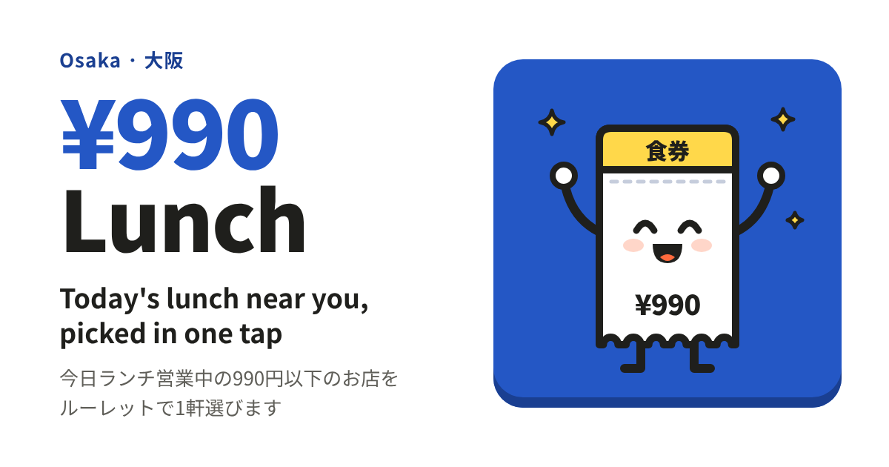
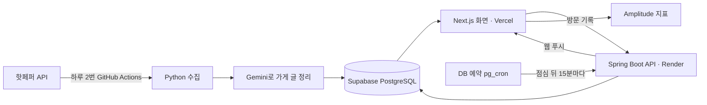

<div align="center">



# 🍱 오사카 990엔 점심 도감

**오사카에서 지금 점심 영업 중인 990엔 이하 가게를 근처에서 골라 주는 웹 앱**

[앱 열어 보기](https://osaka-lunch-app.vercel.app) · [日本語](README.ja.md)

[](https://github.com/bettsLee/osaka_lunch_app/actions/workflows/frontend-ci.yml)
[](https://github.com/bettsLee/osaka_lunch_app/actions/workflows/backend-ci.yml)
[](https://github.com/bettsLee/osaka_lunch_app/actions/workflows/collect-shops.yml)


</div>

## 왜 만들었나

일본에서 지내며 점심을 고를 때마다, 구글맵에서 가게마다 영업시간과 가격을 하나씩 확인해야 했습니다.

이 불편을 주제로 **문제를 직접 찾고 → 만들고 → 출시해서 → 숫자로 고치는 과정**을 혼자 처음부터 끝까지 해 보고 있습니다.

## 기능

- 지금 위치 근처에서 **오늘 점심 영업하는 가게만** 보여 줌 (가격 상한 790 · 990 · 1,190엔)
- 룰렛 · 목록 · 지도로 고르기. 걸어서 몇 분인지, 점심이 몇 시까지인지, 가격대를 한눈에
- 주문 도우미: 직원에게 보여 줄 일본어 문장 (알레르기 · 채식 · 할랄 포함)
- 가게 도착을 알아채고, 먹은 뒤 '점심 어땠어요?'(영업했는지 · 가격이 맞았는지)를 물어 나만의 도감에 모음
- 추천 링크 공유, 휴대폰 언어에 맞춘 다국어, 홈 화면에 추가(PWA)

## 구조



| 영역 | 기술 | 하는 일 |
| --- | --- | --- |
| 화면 | Next.js 15 · TypeScript · Tailwind CSS (Vercel) | 위치 기반 목록 · 룰렛 · 지도, PWA, 웹 푸시 받기 |
| 서버 | Spring Boot 3.5 · Java 17 (Render) | 방문 기록, 알림 보내기, 다국어 문구, 공유 링크 |
| DB | Supabase PostgreSQL | 가게 · 방문 · 알림 구독 저장, RLS, 익명 로그인, pg_cron 예약 |
| 수집 · AI | Python · Gemini (GitHub Actions) | 오사카 가게 약 4,300곳을 하루 2번 받고, 바뀐 가게 글만 AI로 정리 |
| 운영 | GitHub Actions · Amplitude | CI, 배포 뒤 새 버전 확인, 퍼널 · 재방문 지표 |

## 중요한 결정

### 1. 규칙 대신 AI, 대신 정답지로 확인

핫페퍼 가게 글을 정규식으로 읽으면 영업 요일까지 맞힌 가게가 40%뿐이었습니다. Gemini로 글을 정리하고 직접 만든 정답지 30곳과 비교해 요일 판정 40% → 100%, 990엔 판정 87% → 100%로 올렸습니다. 전체에 돌린 뒤 무작위 20곳을 다시 확인해 19곳이 일치했고, 나머지 1곳은 그사이 가게 글이 바뀐 경우였습니다. 글이 바뀐 가게만 다시 처리해 AI 비용을 하루 약 $0.15로 유지합니다.

### 2. 1,000엔이 아니라 990엔

'1000円～'처럼 대략 적힌 가격은 실제로 1,000엔을 넘을 가능성이 커서 기준을 990엔 이하로 잡았습니다. 보여 주는 가게가 줄더라도 믿을 수 있는 가격만 보여 줍니다.

### 3. 데이터 이용 조건을 직접 확인

핫페퍼 운영사(리크루트)에 이용 조건을 문의하고 답변에 맞춰 고쳤습니다. 가게 글 번역을 끄고, AI가 만든 값에는 'AI' 표시를 붙이고, 데이터는 24시간 안에 새로 받습니다.

### 4. 알림이 한 번도 나가지 않던 문제

실행 기록을 보니 15분마다 돌아야 할 GitHub 예약이 실제로는 하루 2번만 실행되고 있었습니다. DB 예약(pg_cron)으로 옮기고, 두 곳에서 동시에 불러도 한 번만 보내도록 DB 잠금(비관적 락)을 넣었습니다.

## 폴더

```
frontend/   Next.js 화면
backend/    Spring Boot API
batch/      핫페퍼 수집 · AI 정리 (Python)
supabase/   DB 마이그레이션 · 점검 쿼리
.github/    CI · 수집 · 알림 · 배포 확인 워크플로
```

## 로컬에서 실행

각 폴더의 `.env.example`에 필요한 키 이름이 있습니다. 값은 저장소에 올리지 않습니다.

```bash
# 화면
cd frontend
cp .env.example .env.local   # 값 채우기
npm install
npm run dev

# 서버 (backend/.env.example의 값을 환경 변수로 넣은 뒤)
cd backend
./gradlew bootRun

# 수집 (받기만 하고 저장하지 않음)
python3 batch/collect.py --dry-run
```

## 테스트

```bash
cd frontend && npm test
cd backend && ./gradlew test
python3 -m unittest discover -s batch -p 'test_*.py'
```

## 일하는 방식

- 모든 결정을 '고른 것 · 버린 것 · 이유 · 근거 데이터'로 기록합니다 (110건 넘게)
- 기능마다 브랜치 → PR → CI → 배포. 배포 뒤에는 화면 · 서버가 새 버전으로 떴는지 자동으로 확인합니다
- AI 도구(Claude Code)와 함께 설계 · 구현 · 리뷰를 하고, 무엇을 만들지는 직접 정합니다

## 진행 상황

- [x] MVP, 가게 수집, AI 정리 (2026.10)
- [ ] 지인 베타 (2026.11) → 출시 (2026.12)
- [ ] A/B 실험, 부하 테스트, 실패 처리 큐 (2026.12)

## 데이터 출처

가게 정보: [Powered by ホットペッパーグルメ Webサービス](http://webservice.recruit.co.jp/)

AI가 정리한 값은 앱에서 'AI'로 표시합니다.

---

만든 사람: 이상권 (기획 · 개발 · 운영)
