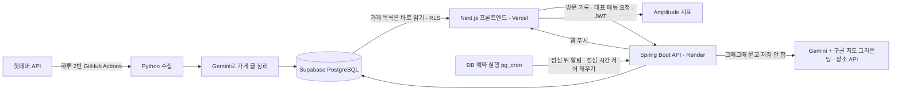

<div align="center">


# 🍱 오사카 990엔 점심 도감

**오사카에서 지금 점심 영업 중인 990엔 이하 가게를 근처에서 골라 주는 웹 앱**

[앱 열어 보기](https://osaka-lunch-app.vercel.app) · [日本語](README.ja.md)

[](https://github.com/bettsLee/osaka_lunch_app/actions/workflows/frontend-ci.yml)
[](https://github.com/bettsLee/osaka_lunch_app/actions/workflows/backend-ci.yml)
[](https://github.com/bettsLee/osaka_lunch_app/actions/workflows/collect-shops.yml)


</div>

## 만든 이유

일본에서 점심을 고를 때마다 구글맵에서 가게별 영업시간과 가격을 하나하나 확인해야 해서 번거로웠습니다.

이 문제를 직접 풀어 보려고 기획부터 개발, 출시, 운영까지 혼자 진행하고 있습니다.

## 주요 기능

- 현재 위치 근처에서 **오늘 점심 영업 중인 가게만** 보여 줍니다. 가격 상한은 790엔, 990엔, 1,190엔 중에서 고를 수 있습니다.
- 룰렛, 목록, 지도 중 편한 방식으로 고르고, 걸어서 몇 분인지와 점심 마감 시간, 가격대를 한 화면에서 확인합니다.
- 결과 카드에서 점심 가격과 그 근거가 된 **가게 글 원문 한 줄**, 구글 지도에서 찾은 **대표 메뉴 · 가격대 · 손님 사진 3장**을 함께 봅니다. 메뉴를 찾는 몇 초 동안에는 진행 막대와 주문 팁을 보여 줍니다.
- 점심 가격이 적혀 있지 않은 가게도 스위치 하나로 지도에 함께 띄울 수 있습니다. (기본은 꺼짐)
- 주문 도우미가 직원에게 보여 줄 일본어 문장을 띄워 줍니다. 알레르기, 채식, 할랄 설정도 반영됩니다.
- 가게에 도착하면 자동으로 기록하고, 식사 후에는 영업 여부와 가격이 맞았는지 묻습니다. 다녀온 가게는 나만의 도감에 쌓입니다.
- 맛집 추천 링크 공유, 휴대폰 언어에 맞춘 다국어, 홈 화면 추가(PWA)를 지원합니다.

## 구조



| 영역 | 기술 | 역할 |
| --- | --- | --- |
| 프론트엔드 | Next.js 15, TypeScript, Tailwind CSS (Vercel) | 위치 기반 목록·룰렛·지도(MapLibre, OpenFreeMap), PWA, 웹 푸시 수신 |
| 백엔드 | Spring Boot 3.5, Java 17, Spring Security, JPA (Render) | 방문 기록, 알림 발송, 다국어 문구, 공유 링크, 구글 지도 대표 메뉴·사진 전달 (저장하지 않음) |
| DB | Supabase PostgreSQL | 가게·방문·알림 구독 데이터, RLS, 익명 로그인, pg_cron 예약 |
| 수집·AI | Python, Gemini (GitHub Actions) | 오사카 시내 12개 지역 가게 약 4,300곳을 하루 2번 수집하고, 소개 글이 바뀐 가게만 AI로 정리 |
| 운영 | GitHub Actions, Amplitude | CI, 배포 후 버전 확인, 퍼널·재방문·유입 경로 지표 |

### 읽기와 쓰기를 나눈 이유

- **읽기(가게 목록 · 룰렛 · 지도)**: 브라우저가 Supabase REST로 바로 읽습니다. 가게 테이블은 RLS로 '누구나 읽기, 쓰기는 배치만'으로 막아 두었습니다. 무료 서버가 잠들어 있어도 첫 화면은 바로 뜹니다.
- **쓰기와 외부 호출(방문 기록 · 알림 구독 · 대표 메뉴 · 사진 · 번역)**: Spring Boot 서버를 거칩니다. Supabase 익명 로그인이 준 JWT를 서버가 직접 검증합니다(서명, 발급처, 대상). Gemini와 구글 키는 서버에만 두고, 하루 호출 한도로 비용이 늘지 않게 막습니다.
- **예약 작업**: 수집은 GitHub Actions, 알림과 서버 깨우기는 DB 예약 실행(pg_cron)이 맡습니다.

## 주요 의사결정

### 1. 정규식 대신 AI로 정리하고, 정답지로 정확도 검증

핫페퍼의 가게 소개 글을 정규식으로 읽었을 때, 영업 요일을 모두 맞힌 가게는 40%에 그쳤습니다. 그래서 Gemini로 글을 정리하고 직접 만든 정답지 30곳과 비교해, 요일 판정 정확도를 40%에서 100%로, 990엔 판정을 87%에서 100%로 올렸습니다.

전체 가게에 적용한 뒤 무작위로 20곳을 다시 확인한 결과 19곳이 일치했습니다. 나머지 1곳은 그사이 가게 글이 바뀐 경우였습니다. 지금은 글이 바뀐 가게만 다시 처리해 AI 비용을 하루 약 $0.15로 유지하고 있습니다. (구현은 [기술 1](#1-ai-정리-파이프라인-정확도--비용--실패를-함께-관리))

### 2. 기준 가격을 1,000엔이 아닌 990엔으로

'1000円～'처럼 대략 적힌 가격은 실제로 1,000엔을 넘는 경우가 많았습니다. 보여 주는 가게 수가 줄더라도 믿을 수 있는 가격만 보여 주기 위해 기준을 990엔 이하로 정했습니다.

### 3. 데이터 이용 조건에 맞춰 설계

- **핫페퍼**: 운영사(리크루트)에 이용 조건을 직접 문의하고, 답변에 맞춰 기능을 고쳤습니다. 가게 글 번역 기능을 없앴고, AI가 읽은 가격에는 'AI가 가게 글에서 읽음' 표시와 함께 가게 글 원문을 고치지 않고 그대로 보여 줍니다. 데이터는 24시간 안에 갱신합니다.
- **구글 지도**: 대표 메뉴, 가격대, 손님 사진은 저장하지 않고 카드를 열 때마다 받아 옵니다. 출처 링크와 'Google Maps' 표기, 사진을 올린 사람을 함께 보여 줍니다. 손님 사진 속 메뉴판을 AI로 읽어 가격을 뽑는 방법도 검토했지만, 구글 지도 콘텐츠로 새 콘텐츠를 만드는 것이 약관에 어긋나서 하지 않았습니다.

### 4. 대표 메뉴 빈칸을 원인별로 줄이기

구글 지도 그라운딩으로 대표 메뉴를 붙인 뒤 30곳을 테스트해 보니 메뉴가 뜬 곳은 16곳뿐이었습니다. 빈칸을 원인별로 나눠 보니, 출처 없이 돌아온 답은 모두 AI가 구글 지도를 찾아보지 않은 경우였고, 다시 물으면 6곳 중 4곳이 메뉴를 찾았습니다.

그래서 한 번 자동으로 다시 묻고, 그래도 출처가 없으면 메뉴만 'AI 추측'으로 구분해 보여 줍니다. 이때 AI 추측 답의 가격과 영업 정보는 버립니다. 또 점심 뒤 '지금 닫힘'을 폐업으로 잘못 답하는 경우가 있어서, 구글 지도에 영구 폐업으로 표시된 가게만 폐업으로 안내합니다. (구현은 [기술 4](#4-느린-외부-ai를-기다리는-화면))

### 5. 점심 가격을 모르는 가게 63%를 다루는 법

수집한 가게 4,288곳 중 2,688곳(63%)은 소개 글에 점심 가격이 없어 앱에 나오지 않았습니다. 구글 답으로 가격을 채워 저장하는 방법은 약관 때문에 쓸 수 없었습니다. 대신 '가격 모르는 곳도' 스위치를 켜면 이 가게들을 회색 점선 핀으로 함께 보여 주고, 카드에서는 구글 지도 가격대를 참고로 붙입니다. 스위치를 켜면 고를 수 있는 가게가 약 4배로 늘어나지만, '990엔 점심'이라는 약속이 흐려지지 않도록 기본은 꺼 두었습니다.

### 6. 실험으로 접은 아이디어: 메뉴별 가격

메뉴마다 가격을 붙이고 싶어서, Gemini에 '가격이 알려진 메뉴와 점심 세트를 먼저 골라 달라'고 묻는 질문을 기존 질문과 같은 30곳에서 비교했습니다. 시작 전에 '30곳 중 10곳 이상에서 가격이 붙으면 바꾼다'는 기준을 먼저 정했습니다.

결과는 가격이 붙은 메뉴가 기존 0/50, 새 질문 0/44였고, 점심 메뉴를 찾은 가게는 10곳에서 6곳으로 오히려 줄었습니다. 그래서 기존 질문을 유지했습니다.

## 기술적으로 풀어 본 문제

### 1. AI 정리 파이프라인: 정확도 · 비용 · 실패를 함께 관리

[`batch/ai_structure.py`](batch/ai_structure.py) · [`batch/structure_shops.py`](batch/structure_shops.py) · [`batch/collect.py`](batch/collect.py)

- **환각 막기**: AI가 '990엔 이하'라고 답해도, 근거로 든 문구가 가게 글 원문에 그대로 없으면 '모름'으로 낮춥니다. 정답지 채점 스크립트([`batch/eval_ai.py`](batch/eval_ai.py))로 정규식과 AI를 같은 지표로 비교합니다.
- **바뀐 것만 다시 처리**: 가게 글의 SHA-256 해시, 모델, 프롬프트 버전 중 하나라도 바뀐 가게와 지난번에 실패한 가게만 다시 AI에 보냅니다. 처음 전체 처리(약 2,900곳)는 23분이 걸렸지만, 평소에는 몇 분이면 끝납니다.
- **실행 관리**: 스레드 풀로 동시 32개를 처리하고, 45분이 지나면 남은 가게는 다음 실행으로 넘깁니다. 실패가 절반을 넘으면(3곳 이상) 키나 한도 문제로 보고 배치를 실패로 끝내서 알 수 있게 합니다.
- **수집 안전장치**: 약관상 24시간 안에 갱신해야 해서, 이번 수집에 안 보인 가게는 지웁니다. 다만 받은 수가 기존의 절반도 안 되면 API 이상으로 보고 지우지 않고 멈춥니다. 예약이 밀려도 24시간을 넘지 않도록 하루 2번 돌립니다.

### 2. 무료 서버가 잠드는 환경에서도 빠르게

무료 서버(Render)는 15분 동안 요청이 없으면 잠들고, 잠든 뒤 첫 요청은 서버가 깨어날 때까지 기다려야 합니다.

- 가게 목록은 서버를 거치지 않고 Supabase에서 바로 읽습니다.
- 룰렛이 도는 동안 서버의 `/health`를 불러 깨우고, 같은 시간에 뽑힌 가게의 대표 메뉴도 미리 물어 둡니다(prefetch).
- '여기 갈래요'는 브라우저 보관함(outbox, localStorage)에 먼저 넣고 뒤에서 보냅니다. 기록 ID(UUID)를 브라우저가 만들기 때문에, 서버가 잠들어 같은 요청을 다시 보내도 한 번만 저장됩니다(멱등). 3일이 지난 기록은 버립니다. ([`frontend/lib/api.ts`](frontend/lib/api.ts))
- 점심 시간(10:00~17:50)에는 DB 예약 실행이 10분마다 서버를 깨웁니다.

### 3. '다녀왔어요?' 웹 푸시

[`push/PushJob.java`](backend/src/main/java/com/osakalunch/backend/push/PushJob.java) · [`push/WebPushCrypto.java`](backend/src/main/java/com/osakalunch/backend/push/WebPushCrypto.java) · [`visit/VisitRepository.java`](backend/src/main/java/com/osakalunch/backend/visit/VisitRepository.java)

- **문제**: 알림이 한 번도 나가지 않았습니다. 실행 기록을 보니 15분마다 돌아야 할 GitHub Actions 예약이 실제로는 하루 2번쯤만 실행되고 있었습니다.
- **해결**: 예약 실행을 Supabase pg_cron으로 옮기고 GitHub Actions는 예비로 남겼습니다. 두 곳이 동시에 불러도 같은 기록에 두 번 보내지 않도록, 보낼 대상을 고르는 쿼리에 비관적 락(`PESSIMISTIC_WRITE`)을 걸었습니다. 알림을 끈 브라우저(404 · 410)의 구독은 지우고, 일시적 실패만 다음 실행에서 다시 보냅니다.
- **직접 구현**: Web Push 내용 암호화(RFC 8291 aes128gcm: ECDH → HKDF → AES-GCM)와 VAPID 인증(ES256 JWT)을 라이브러리 없이 Java 표준 API로 만들고, RFC에 나온 예시 값과 암호문이 같은지 테스트합니다. 구독을 저장할 때는 브라우저 공개 키가 P-256 곡선 위의 점인지 확인합니다.

### 4. 느린 외부 AI를 기다리는 화면

[`menu/MenuHintClient.java`](backend/src/main/java/com/osakalunch/backend/menu/MenuHintClient.java) · [`components/MenuHintBlock.tsx`](frontend/components/MenuHintBlock.tsx)

구글 지도 그라운딩 응답은 중간값 약 5.5초, 길면 10초가 넘게 걸립니다.

- **시간 예산 안에서만 재시도**: 전체 20초 안에서, 답에 구글 지도 근거(`groundingChunks`)가 없을 때만 한 번 더 묻습니다. 남은 시간이 4초보다 적거나 이미 시간 초과로 끝났다면 다시 묻지 않습니다.
- **비용 한도**: 그라운딩 무료 범위(월 5,000회)에 맞춰 하루 150회(오사카 날짜 기준) 한도를 두고, 재시도도 같은 한도에서 셉니다. 사진은 장소 API 필드 마스크를 `photos`로만 좁혀 가장 낮은 요금 등급을 쓰고, 하루 33장(월 무료 1,000장 이내)으로 막습니다.
- **저장하지 않기**: 응답에 `Cache-Control: no-store`를 붙여 브라우저와 중간 서버도 보관하지 않습니다.
- **화면**: 기다리는 문구를 0 · 4 · 9 · 15초에 바꾸고 진행 막대와 주문 팁을 보여 줍니다. 답이 오면 1.2초 동안 높이를 유지했다가 줄여서, 아래 버튼이 갑자기 올라가 잘못 눌리지 않게 했습니다.

### 5. 다국어: 필요한 언어만 한 번 번역해 저장

[`i18n/TranslationService.java`](backend/src/main/java/com/osakalunch/backend/i18n/TranslationService.java)

- 한국어와 영어는 앱에 넣어 두고, 그 밖의 언어는 휴대폰 언어로 처음 열 때 서버가 Gemini로 한 번 번역해 DB에 저장합니다. 원문 버전이나 지시문 버전이 바뀌면 다시 번역합니다.
- 번역 결과의 `{자리}` 표시가 원문과 하나라도 다르면 쓰지 않습니다. 새 번역은 시간당 20개로 제한해, 언어 코드를 바꿔 가며 불러도 비용이 늘지 않게 했습니다.
- 베트남어에서 '이하(≤)'를 '미만(<)'으로 옮긴 문구가 11개 중 8개였는데, 지시문을 고쳐 11개 모두 맞게 했습니다.

### 6. 배포 확인 자동화

[`.github/workflows/deploy-check.yml`](.github/workflows/deploy-check.yml)

- **문제**: Vercel 환경 변수의 서버 주소 끝에 `/health`가 붙어서, 앱의 서버 호출이 전부 404였습니다. 테스트와 CI는 통과해서 잡지 못했습니다.
- **해결**: main에 머지되면 ① Vercel 운영 배포가 이 커밋으로 끝났는지 ② 배포된 화면 코드(JS)가 운영 서버 주소를 쓰는지 ③ Render의 `/health`가 돌려주는 커밋이 맞는지를 자동으로 확인합니다. 서버 코드가 바뀌지 않은 커밋은 서버가 다시 배포되지 않으므로, ③은 마지막 서버 커밋 이후 서버 코드 변경이 없으면 통과로 봅니다.

## 데이터와 보안

| 테이블 | 담는 것 | 접근 |
| --- | --- | --- |
| `shops` | 핫페퍼 가게 정보 (하루 2번 갱신) | 누구나 읽기, 쓰기는 배치만 |
| `shop_ai` | AI 정리 결과 (요일별 점심 영업, 가격, 근거 문구, 글 해시) | 누구나 읽기, 쓰기는 배치만 |
| `visits` | 여기 갈래요 · 도착 · 답 | 본인 것만 읽기, 쓰기는 서버 |
| `push_subscriptions` | 웹 푸시 구독 | 서버만 |
| `translations` | 언어별 앱 문구 번역 | 서버만 |
| `opinions` · `share_links` | 의견 · 추천 링크 | 서버만 |

- 모든 테이블에 RLS를 켜고, 정책이 없는 테이블은 브라우저에서 접근할 수 없습니다.
- 구글 지도 콘텐츠는 저장하는 테이블이 없습니다. 방문 기록에 남긴 핫페퍼 가게 이름은 24시간이 지나면 배치가 비웁니다.
- 로그에는 푸시 구독 주소 전체를 남기지 않습니다. 사용자를 식별할 수 있는 값이라 호스트 이름만 남깁니다.
- 비밀 값은 GitHub Secrets와 Vercel · Render 환경 변수에만 두고, 저장소에는 `.env.example`에 이름만 둡니다.

## 테스트와 CI

| 영역 | 도구 | 수 | 내용 |
| --- | --- | --- | --- |
| 백엔드 | JUnit, MockMvc | 60개 | CI에서 실제 PostgreSQL 16 컨테이너로 실행. Gemini · 장소 API 응답은 가짜로 바꿔 재시도 · 한도 · 시간 초과를 시험 |
| 프론트엔드 | node:test | 66개 | 가격 판정, 도착 판정(GPS 오차 100m 넘으면 판단 안 함), 서버 응답 검증, 방문 보관함 |
| 배치 | unittest | 28개 | 점심 시간 규칙, 실패한 가게 처리(대부분 실패하면 멈춤), 24시간 지난 가게 이름 비우기 |

- 프론트엔드 · 백엔드 CI가 따로 돌고, main에 머지되면 배포 확인이 이어서 돕니다. 배치 테스트는 아직 로컬에서만 돌립니다.
- Gemini 질문을 바꿀지 판단하는 실험은 실험 브랜치에 push하면 도는 워크플로로 실제 API를 불러 비교합니다. 공개 로그에는 숫자만 남기고, main에는 머지하지 않습니다.

## 폴더 구조

```
frontend/   Next.js 프론트엔드 (components/ 화면, lib/ 화면 밖 로직과 테스트)
backend/    Spring Boot API (visit · push · menu · i18n · share · opinion)
batch/      핫페퍼 수집, AI 정리, 정답지 채점, 실험 스크립트 (Python)
supabase/   DB 마이그레이션(001~015), 점검 쿼리
.github/    CI, 수집, 알림, 배포 확인 워크플로
```

## 로컬 실행

각 폴더의 `.env.example`에 필요한 환경 변수 이름이 있습니다. 실제 값은 저장소에 올리지 않습니다.

```bash
# 프론트엔드
cd frontend
cp .env.example .env.local   # 값 입력
npm install
npm run dev

# 백엔드 (backend/.env.example의 값을 환경 변수로 설정한 뒤)
cd backend
./gradlew bootRun

# 수집 (조회만 하고 저장하지 않음)
python3 batch/collect.py --dry-run
```

## 테스트 실행

```bash
cd frontend && npm test
cd backend && ./gradlew test
python3 -m unittest discover -s batch -p 'test_*.py'
```

## 작업 방식

- 모든 의사결정을 '선택한 것, 버린 것, 이유, 근거 데이터'로 기록합니다. (현재 130건 이상)
- 바꿀지 말지 애매한 것은 기준을 먼저 정하고 작은 실험으로 확인합니다.
- 기능마다 브랜치 → PR → CI → 배포 순서로 진행하고, 배포 후에는 프론트엔드와 백엔드가 새 버전으로 떴는지 자동으로 확인합니다.
- 설계, 구현, 리뷰는 AI 도구(Claude Code)와 함께 하고, 무엇을 만들지는 직접 결정합니다.

## 진행 상황

- [x] MVP, 가게 수집, AI 정리 (2026.10)
- [x] 결과 카드에 구글 지도 대표 메뉴 · 가격대 · 손님 사진, 가격 모르는 가게 보기 (2026.11)
- [ ] 지인 베타 (2026.11.17~20) → 출시 (2026.11.24)
- [ ] 출시 뒤 숫자를 보고 다음 개선 고르기 (A/B 테스트, 부하 테스트)

## 데이터 출처

- 가게 정보: [Powered by ホットペッパーグルメ Webサービス](http://webservice.recruit.co.jp/)
- 대표 메뉴 · 가격대 · 손님 사진: Google Maps (저장하지 않고, 앱에서 출처와 사진 올린 사람을 함께 표시)
- 지도: [OpenFreeMap](https://openfreemap.org) · © [OpenMapTiles](https://www.openmaptiles.org/) · © [OpenStreetMap](https://www.openstreetmap.org/copyright) contributors

AI가 정리한 값은 앱에서 'AI'로 표시합니다.

---

만든 사람: 이상권 (기획, 개발, 운영)
